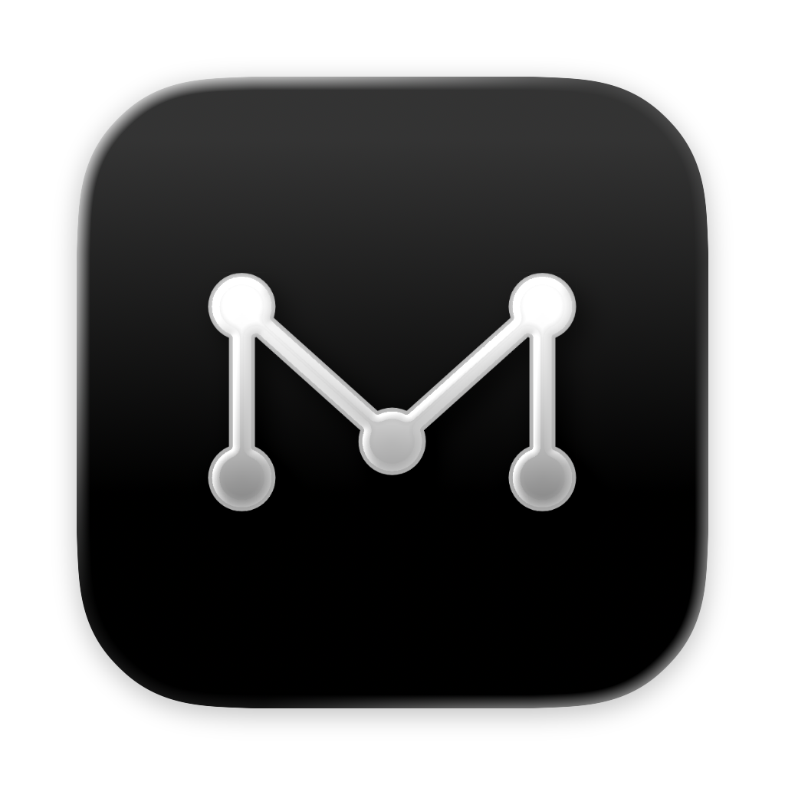
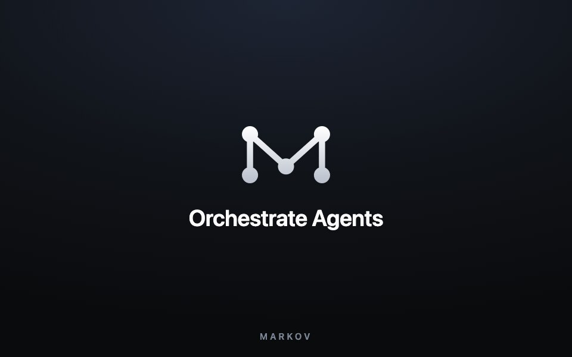
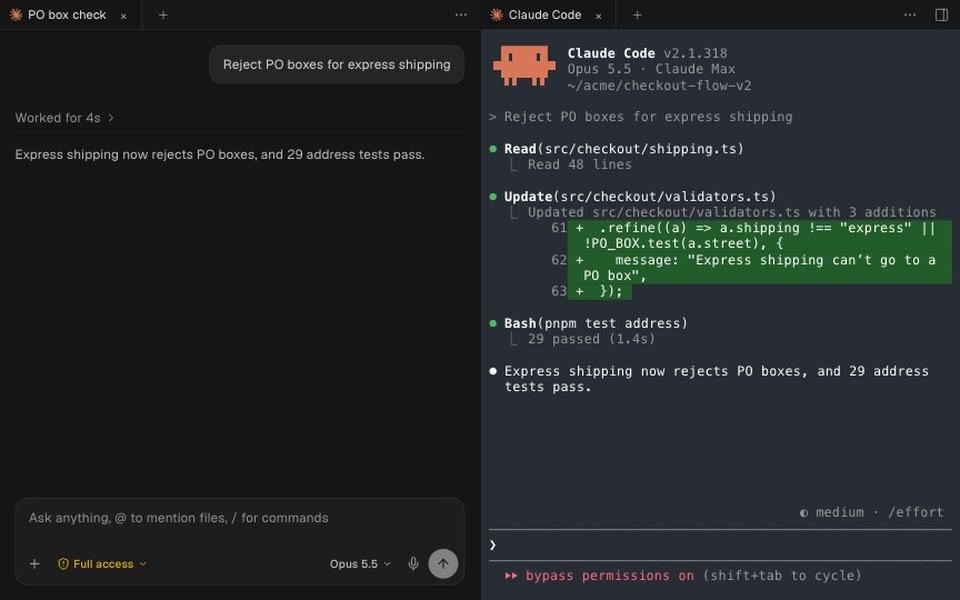
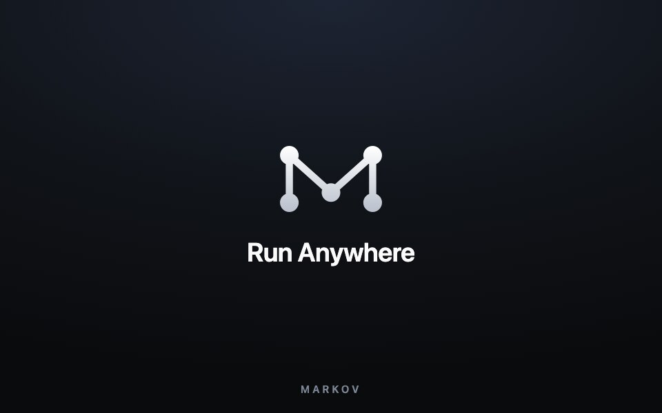
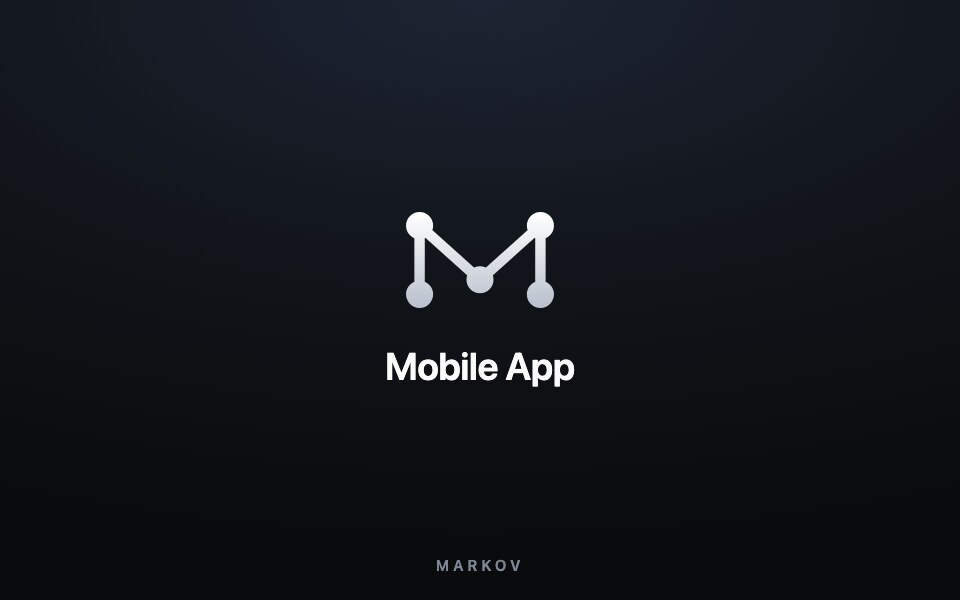
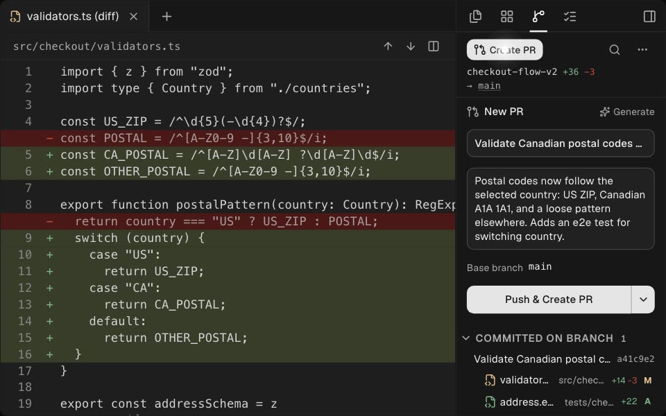
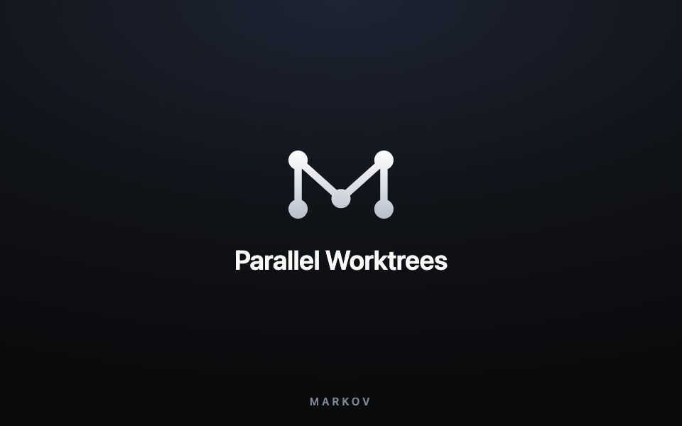
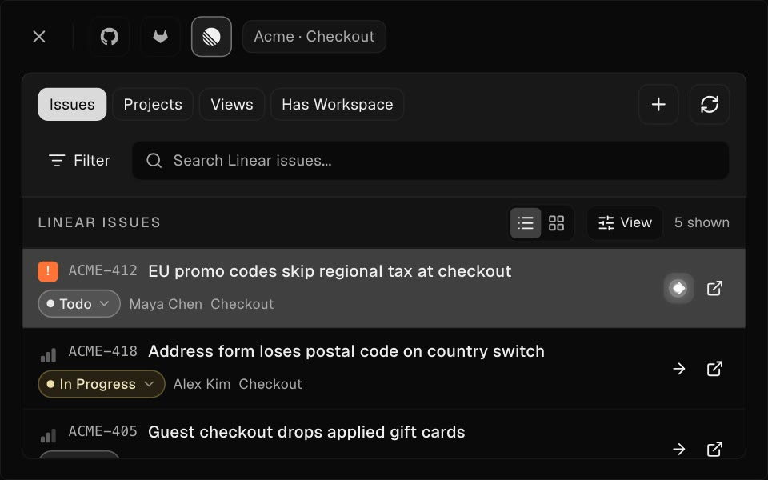
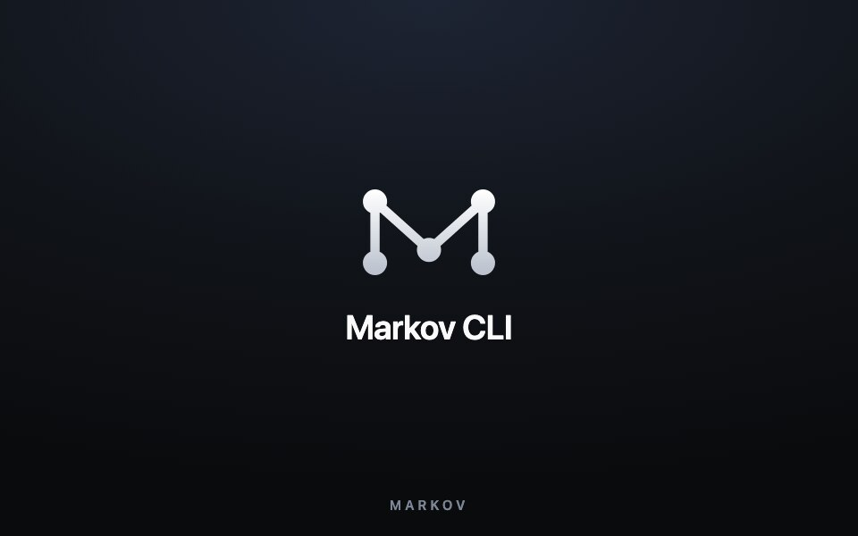
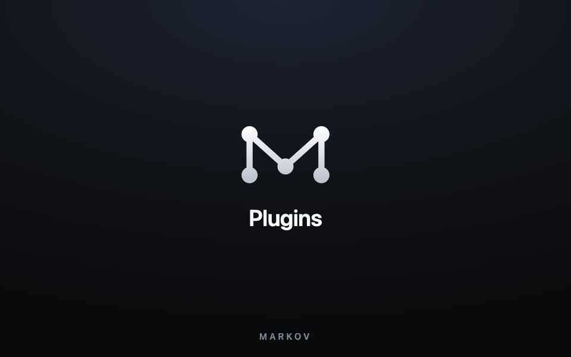

<h1 align="center">
  <a href="https://markov.outhad.com"></a> Markov
</h1>

<p align="center">
  <a href="https://github.com/tanzil7890/markov"></a>
  <a href="https://github.com/tanzil7890/markov/releases"></a>
  
  
</p>

<p align="center">
  <sub><a href="docs/readme/README.zh-CN.md">中文</a> · <a href="docs/readme/README.ja.md">日本語</a> · <a href="docs/readme/README.ko.md">한국어</a> · <a href="docs/readme/README.es.md">Español</a> · <a href="docs/readme/README.fr.md">Français</a> · <a href="docs/readme/README.pt.md">Português</a> · <a href="docs/readme/README.tr.md">Türkçe</a> · <a href="docs/readme/README.ru.md">Русский</a></sub>
</p>

<p align="center">
  <strong>The AI Orchestrator for 100x builders.</strong><br/>
  Run Claude Code, Codex, and any other coding agent in parallel, each in its own worktree. Chat or terminal, on your laptop or in the cloud, with diffs, a browser, and a CLI in one app.
</p>

<h3 align="center"><a href="https://markov.outhad.com/download"><ins>Download Markov</ins></a></h3>

## Features

<table>
<tr>
<td width="50%" valign="middle">

### Orchestrate Agents

Hand a big task to one agent. It splits the work, starts worker agents in their own workspaces, and brings their results back to you.

[Docs →](https://markov.outhad.com/docs/cli/orchestration)

</td>
<td width="50%">
  <a href="https://markov.outhad.com/docs/cli/orchestration"><picture><source srcset="docs/assets/readme-features/orchestration.webp" type="image/webp"></picture></a>
</td>
</tr>
<tr>
<td width="50%" valign="middle">

### Chat or Terminal

Run any agent in Chat UI or as the raw CLI, and move a conversation between the two without losing context.

[Docs →](https://markov.outhad.com/docs/agents/native-chat)

</td>
<td width="50%">
  <a href="https://markov.outhad.com/docs/agents/native-chat"><picture><source srcset="docs/assets/readme-features/chat-or-terminal.webp" type="image/webp"></picture></a>
</td>
</tr>
<tr>
<td width="50%" valign="middle">

### Run Anywhere

Pair a Remote Markov Server, work on any SSH host, or give a worktree its own cloud VM. Your agents keep running when your laptop sleeps.

[Docs →](https://markov.outhad.com/docs/ways-to-run)

</td>
<td width="50%">
  <a href="https://markov.outhad.com/docs/ways-to-run"><picture><source srcset="docs/assets/readme-features/remote.webp" type="image/webp"></picture></a>
</td>
</tr>
<tr>
<td width="50%" valign="middle">

### Mobile App

Pair Markov with the mobile app to get pinged when an agent needs you, reply in chat, and keep work moving on any of your machines when you are away from your desk.

[iOS App Store](https://markov.outhad.com/download/ios) · [Android APK](https://markov.outhad.com/download/android) · [Docs →](https://markov.outhad.com/docs/mobile)

</td>
<td width="50%">
  <a href="https://markov.outhad.com/docs/mobile"><picture><source srcset="docs/assets/readme-features/mobile-companion.webp" type="image/webp"></picture></a>
</td>
</tr>
<tr>
<td width="50%" valign="middle">

### Review AI Output

Review diffs, leave notes on exact changed lines, and send focused feedback back to an agent.

[Docs →](https://markov.outhad.com/docs/review/annotate-ai-diff)

</td>
<td width="50%">
  <a href="https://markov.outhad.com/docs/review/annotate-ai-diff"><picture><source srcset="docs/assets/readme-features/annotate-ai-diffs.webp" type="image/webp"></picture></a>
</td>
</tr>
<tr>
<td width="50%" valign="middle">

### Git Integration

Draft commit messages and pull requests from the diff, then send failing checks or PR review comments back to an agent to fix.

[Docs →](https://markov.outhad.com/docs/review/commit-push)

</td>
<td width="50%">
  <a href="https://markov.outhad.com/docs/review/commit-push"><picture><source srcset="docs/assets/readme-features/git-integration.webp" type="image/webp"></picture></a>
</td>
</tr>
<tr>
<td width="50%" valign="middle">

### Parallel Worktrees

Quickly split tasks into isolated environments, so multiple agents can work side by side without interfering with each other.

[Docs →](https://markov.outhad.com/docs/model/worktrees)

</td>
<td width="50%">
  <a href="https://markov.outhad.com/docs/model/worktrees"><picture><source srcset="docs/assets/readme-features/parallel-worktrees.webp" type="image/webp"></picture></a>
</td>
</tr>
<tr>
<td width="50%" valign="middle">

### Design Mode

Click any element in Markov's browser to copy its HTML, styles, and selector, then paste it into your agent's chat.

[Docs →](https://markov.outhad.com/docs/browser/design-mode)

</td>
<td width="50%">
  <a href="https://markov.outhad.com/docs/browser/design-mode"><picture><source srcset="docs/assets/readme-features/design-mode.webp" type="image/webp"></picture></a>
</td>
</tr>
<tr>
<td width="50%" valign="middle">

### GitHub &amp; Linear, Native

See your GitHub and Linear tasks in one place, and start a workspace for each when you're ready to build.

[Docs →](https://markov.outhad.com/docs/review/linear)

</td>
<td width="50%">
  <a href="https://markov.outhad.com/docs/review/linear"><picture><source srcset="docs/assets/readme-features/github-linear-tasks.webp" type="image/webp"></picture></a>
</td>
</tr>
<tr>
<td width="50%" valign="middle">

### Markov CLI

Anything you can do in Markov, your agents can do too: create worktrees, start workers, drive the browser and desktop apps, and schedule automations, all from the command line.

[Docs →](https://markov.outhad.com/docs/cli/overview)

</td>
<td width="50%">
  <a href="https://markov.outhad.com/docs/cli/overview"><picture><source srcset="docs/assets/readme-features/markov-cli.webp" type="image/webp"></picture></a>
</td>
</tr>
<tr>
<td width="50%" valign="middle">

### Plugins

Themes, editors, languages, and panels from the community, installed in a click.

[Browse plugins →](https://markov.outhad.com/plugins)

</td>
<td width="50%">
  <a href="https://markov.outhad.com/plugins"><picture><source srcset="docs/assets/readme-features/plugins.webp" type="image/webp"></picture></a>
</td>
</tr>
<tr>
<td width="50%" valign="middle">

### Split Anything

Put agents, terminals, browsers, and diffs side by side in split panes shaped to the task.

[Docs →](https://markov.outhad.com/docs/model/tabs-panes-splits)

</td>
<td width="50%">
  <a href="https://markov.outhad.com/docs/model/tabs-panes-splits"><picture><source srcset="docs/assets/readme-features/split-anything.webp" type="image/webp"></picture></a>
</td>
</tr>
</table>

**Also in the box:**

- **[Drag Files to Agents](https://markov.outhad.com/docs/editing/file-explorer)**: drag files from the explorer, or images from your desktop, straight into an agent's prompt.
- **[Jump Anywhere](https://markov.outhad.com/docs/model/quick-open)**: one shortcut jumps to any workspace or tab across every repo and host.
- **[Rich Previews](https://markov.outhad.com/docs/editing/viewers)**: open images, PDFs, and Markdown right in the workspace, next to the agent that made them.
- **[Mobile Emulator](https://markov.outhad.com/docs/cli/overview#mobile-emulator)**: run an iOS Simulator or Android emulator beside your agent, and let it tap, type, and check its own work.
- **[Dictation](https://markov.outhad.com/docs/settings#voice)**: press a shortcut and talk. Markov types what you say into the agent's prompt or terminal.
- **[Usage &amp; Accounts](https://markov.outhad.com/docs/agents/usage-tracking)**: see how much of your agent limits you've used and when they reset, and switch accounts without logging out.
- **[Automations](https://markov.outhad.com/docs/cli/automations)**: schedule prompts to run on any repo: nightly dependency bumps, weekly triage, flaky-test sweeps.
- **[Computer Use](https://markov.outhad.com/docs/cli/computer-use)**: when there's no CLI or API, agents can see and drive desktop apps and external browsers.
- **And many, many more**: we ship daily, so this list is perpetually behind. The [changelog](https://github.com/tanzil7890/markov/releases) is the real feature list.

---

## Supported Agents

Works with **any CLI agent** — if it runs in a terminal, it runs in Markov.

<p>
  <a href="https://docs.anthropic.com/claude/docs/claude-code"><kbd> Claude Code</kbd></a> &nbsp;
  <a href="https://github.com/openai/codex"><kbd> Codex</kbd></a> &nbsp;
  <a href="https://x.ai/cli"><kbd> Grok</kbd></a> &nbsp;
  <a href="https://cursor.com/cli"><kbd> Cursor</kbd></a> &nbsp;
  <a href="https://docs.github.com/en/copilot/how-tos/set-up/install-copilot-cli"><kbd> GitHub Copilot</kbd></a> &nbsp;
  <a href="https://dev.meta.ai/docs/muse-code"><kbd> Muse</kbd></a> &nbsp;
  <a href="https://deepseek-harness.github.io/deepseek-harness/"><kbd> DeepSeek Harness</kbd></a> &nbsp;
  <a href="https://zcode.z.ai/en/docs"><kbd> ZCode</kbd></a> &nbsp;
  <a href="https://opencode.ai/docs/cli/"><kbd> OpenCode</kbd></a> &nbsp;
  <a href="https://mimo.xiaomi.com/coder"><kbd> MiMo Code</kbd></a> &nbsp;
  <a href="https://ampcode.com/manual#install"><kbd> Amp</kbd></a> &nbsp;
  <a href="https://openclaude.gitlawb.com/"><kbd> OpenClaude</kbd></a> &nbsp;
  <a href="https://antigravity.google/docs/cli-overview"><kbd> Antigravity</kbd></a> &nbsp;
  <a href="https://pi.dev"><kbd> Pi</kbd></a> &nbsp;
  <a href="https://omp.sh"><kbd> oh-my-pi</kbd></a> &nbsp;
  <a href="https://hermes-agent.nousresearch.com/docs/"><kbd> Hermes Agent</kbd></a> &nbsp;
  <a href="https://devin.ai/cli"><kbd> Devin</kbd></a> &nbsp;
  <a href="https://goose-docs.ai/docs/quickstart/"><kbd> Goose</kbd></a> &nbsp;
  <a href="https://docs.augmentcode.com/cli/overview"><kbd> Auggie</kbd></a> &nbsp;
  <a href="https://github.com/autohandai/code-cli"><kbd> Autohand Code</kbd></a> &nbsp;
  <a href="https://github.com/charmbracelet/crush"><kbd> Charm</kbd></a> &nbsp;
  <a href="https://docs.cline.bot/cline-cli/overview"><kbd> Cline</kbd></a> &nbsp;
  <a href="https://www.codebuddy.ai/cli"><kbd> CodeBuddy</kbd></a> &nbsp;
  <a href="https://www.codebuff.com/docs/help/quick-start"><kbd> Codebuff</kbd></a> &nbsp;
  <a href="https://freebuff.com"><kbd> Freebuff</kbd></a> &nbsp;
  <a href="https://commandcode.ai/docs/quickstart"><kbd> Command Code</kbd></a> &nbsp;
  <a href="https://docs.continue.dev/cli/quickstart"><kbd> Continue</kbd></a> &nbsp;
  <a href="https://docs.factory.ai/cli/getting-started/quickstart"><kbd> Droid</kbd></a> &nbsp;
  <a href="https://kilo.ai/docs/cli"><kbd> Kilocode</kbd></a> &nbsp;
  <a href="https://www.kimi.com/code/docs/en/kimi-code-cli/getting-started.html"><kbd> Kimi</kbd></a> &nbsp;
  <a href="https://kiro.dev/docs/cli/"><kbd> Kiro</kbd></a> &nbsp;
  <a href="https://github.com/mistralai/mistral-vibe"><kbd> Mistral Vibe</kbd></a> &nbsp;
  <a href="https://github.com/QwenLM/qwen-code"><kbd> Qwen Code</kbd></a> &nbsp;
  <a href="https://support.atlassian.com/rovo/docs/install-and-run-rovo-dev-cli-on-your-device/"><kbd> Rovo Dev</kbd></a> &nbsp;
  <kbd>+ any CLI agent</kbd>
</p>

---

## Install

### Desktop — macOS, Windows, Linux

- **[Download from markov.outhad.com](https://markov.outhad.com/download)**
- Or grab a build directly: [macOS Apple Silicon](https://github.com/tanzil7890/markov/releases/latest/download/markov-macos-arm64.dmg) · [macOS Intel](https://github.com/tanzil7890/markov/releases/latest/download/markov-macos-x64.dmg) · [Windows (.exe)](https://github.com/tanzil7890/markov/releases/latest/download/markov-windows-setup.exe) · [Linux AppImage](https://github.com/tanzil7890/markov/releases/latest/download/markov-linux.AppImage) · [All builds](https://github.com/tanzil7890/markov/releases/latest)

_Or via a package manager:_

```bash
# macOS (Homebrew)
brew install --cask tanzil7890/markov/markov
# Upgrade an existing install
brew upgrade --cask tanzil7890/markov/markov
```

### Mobile App — iOS, Android

Pair with your desktop app to monitor and steer your agents from your phone.

- **iOS:** [Download on the App Store](https://markov.outhad.com/download/ios)
- **Android:** [Download APK](https://markov.outhad.com/download/android) · [Install guide](https://markov.outhad.com/docs/android-apk)

---

## Community &amp; Support

- **GitHub:** [Report a bug or request a feature](https://github.com/tanzil7890/markov/issues).
- **Feedback &amp; Ideas:** We ship fast. Missing something? [Request a new feature](https://github.com/tanzil7890/markov/issues).
- **Privacy:** See the [privacy &amp; telemetry docs](https://markov.outhad.com/docs/telemetry) for what anonymous usage data Markov collects and how to opt out.
- **Show Support:** [Star](https://github.com/tanzil7890/markov) this repo to follow along with our daily ships.

---

## Developing

Want to contribute or run locally? See our [CONTRIBUTING.md](.github/CONTRIBUTING.md) guide.

<a href="https://github.com/tanzil7890/markov/graphs/contributors">
  
</a>

<p align="center">
  
</p>

## Signed Builds

Windows code signing sponsored/provided by [SignPath.io](https://signpath.io), certificate by [SignPath Foundation](https://signpath.org).

## License

Markov is free and open source under the [MIT License](LICENSE).
