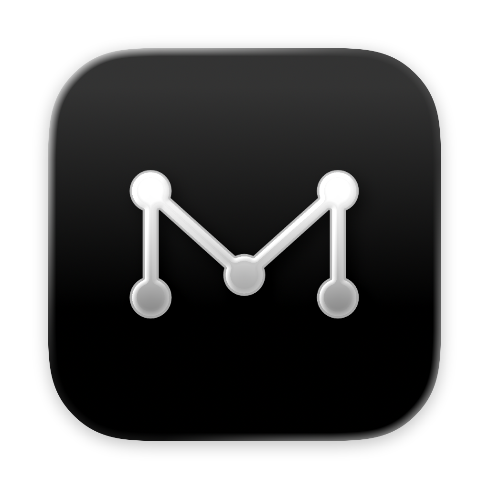
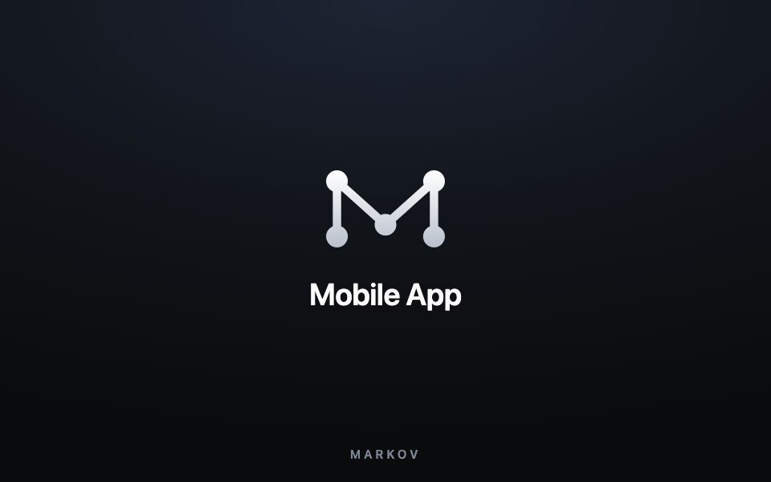
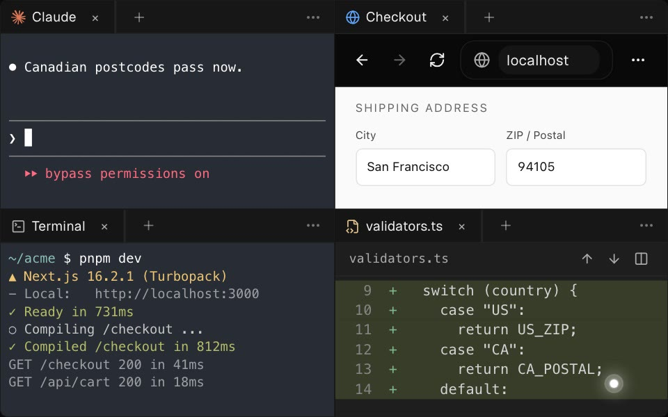
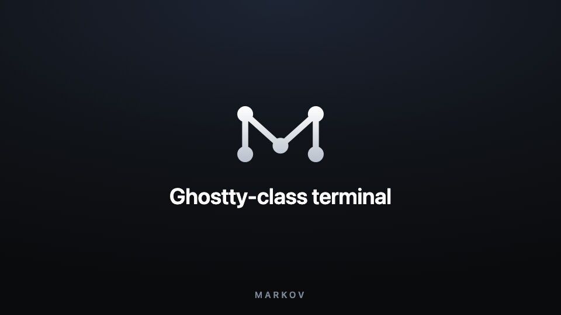
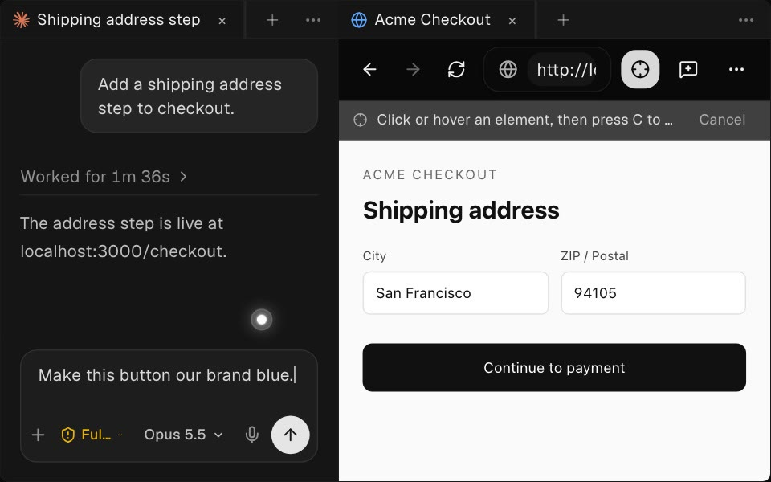
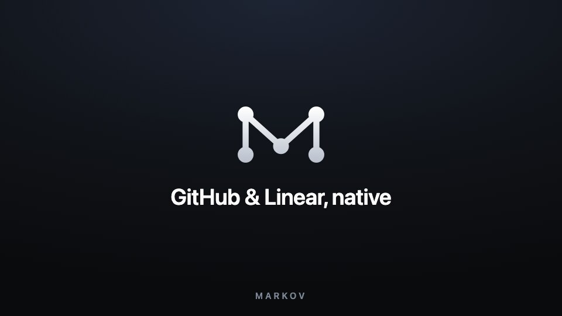
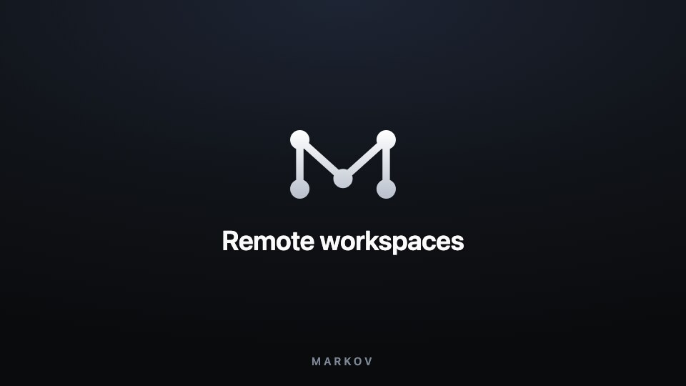
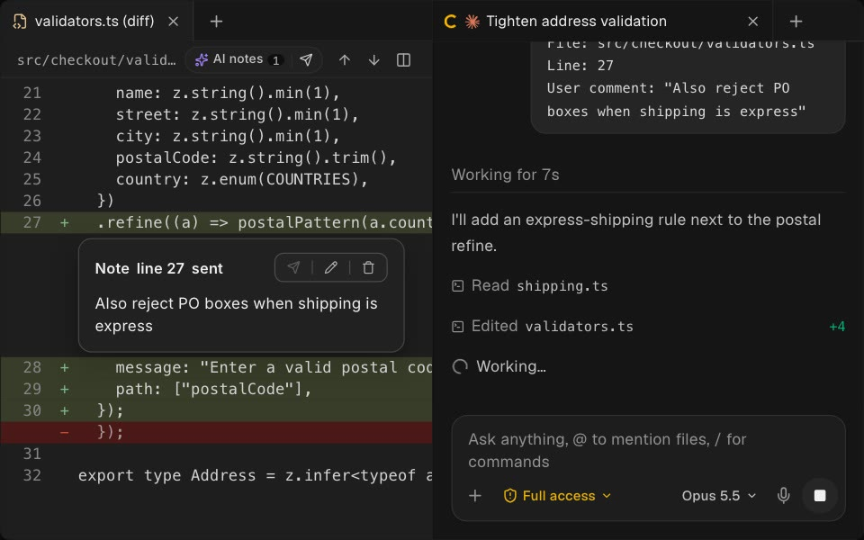
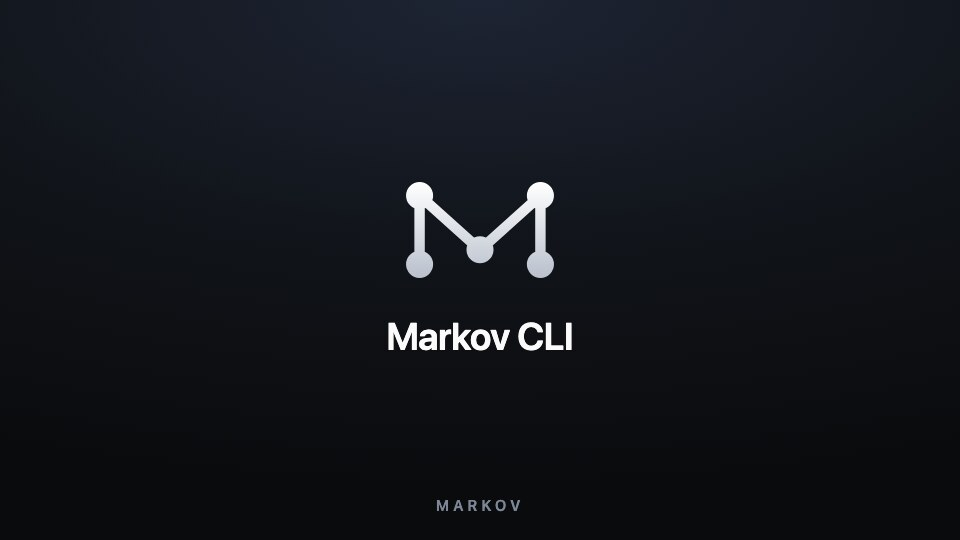
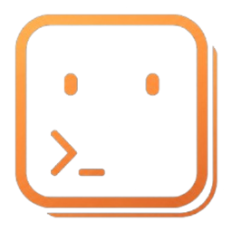

<h1 align="center">
  <a href="https://markov.outhad.com"></a> Markov
</h1>

<p align="center">
  <a href="https://github.com/tanzil7890/markov"></a>
  <a href="https://github.com/tanzil7890/markov/releases"></a>
  
  
</p>

<p align="center">
  <sub><a href="../../README.md">English</a> · <a href="README.zh-CN.md">中文</a> · <a href="README.ja.md">日本語</a> · <a href="README.ko.md">한국어</a> · <a href="README.es.md">Español</a> · <a href="README.fr.md">Français</a> · <a href="README.tr.md">Türkçe</a> · <a href="README.ru.md">Русский</a></sub>
</p>

<p align="center">
  <strong>O orquestrador de IA para builders 100x.</strong><br/>
  Rode Codex, ClaudeCode, OpenCode ou Pi lado a lado — cada um em seu próprio worktree, acompanhado em um só lugar.
</p>

<h3 align="center"><a href="https://markov.outhad.com/download"><ins>Baixar o Markov</ins></a></h3>

## Recursos

<table>
<tr>
<td width="50%" valign="middle">

### Companion móvel

Monitore e conduza seus agentes pelo celular — receba uma notificação quando um agente terminar e envie instruções de acompanhamento de qualquer lugar.

[App Store para iOS](https://markov.outhad.com/download/ios) · [APK Android](https://markov.outhad.com/download/android) · [Docs →](https://markov.outhad.com/docs/mobile)

</td>
<td width="50%">
  <a href="https://markov.outhad.com/docs/mobile"><picture><source srcset="../assets/readme-features/mobile-companion.webp" type="image/webp"></picture></a>
</td>
</tr>
<tr>
<td width="50%" valign="middle">

### Worktrees paralelos

Envie um mesmo prompt para cinco agentes, cada um em seu próprio worktree git isolado — compare os resultados e faça merge do vencedor.

[Docs →](https://markov.outhad.com/docs/model/worktrees)

</td>
<td width="50%">
  <a href="https://markov.outhad.com/docs/model/worktrees"><picture><source srcset="../assets/readme-features/split-anything.webp" type="image/webp"></picture></a>
</td>
</tr>
<tr>
<td width="50%" valign="middle">

### Terminais divididos

Terminais no nível do Ghostty com renderização WebGL, divisões infinitas e scrollback que sobrevive a reinicializações.

[Docs →](https://markov.outhad.com/docs/terminal)

</td>
<td width="50%">
  <a href="https://markov.outhad.com/docs/terminal"><picture><source srcset="../../resources/onboarding/feature-wall/tile-02.webp" type="image/webp"></picture></a>
</td>
</tr>
<tr>
<td width="50%" valign="middle">

### Modo Design

Clique em qualquer elemento de UI em uma janela real do Chromium para enviar HTML, CSS e uma captura recortada direto para o prompt do seu agente.

[Docs →](https://markov.outhad.com/docs/browser/design-mode)

</td>
<td width="50%">
  <a href="https://markov.outhad.com/docs/browser/design-mode"><picture><source srcset="../assets/readme-features/design-mode.webp" type="image/webp"></picture></a>
</td>
</tr>
<tr>
<td width="50%" valign="middle">

### GitHub e Linear nativos

Navegue por PRs, issues e quadros de projeto dentro do app — abra um worktree a partir de qualquer tarefa e revise sem trocar de contexto.

[Docs →](https://markov.outhad.com/docs/review/linear)

</td>
<td width="50%">
  <a href="https://markov.outhad.com/docs/review/linear"><picture><source srcset="../../resources/onboarding/feature-wall/tile-03.webp" type="image/webp"></picture></a>
</td>
</tr>
<tr>
<td width="50%" valign="middle">

### Worktrees por SSH

Execute agentes em uma máquina remota potente com edição completa de arquivos, git e terminais — com reconexão automática e encaminhamento de portas incluídos.

[Docs →](https://markov.outhad.com/docs/ssh)

</td>
<td width="50%">
  <a href="https://markov.outhad.com/docs/ssh"><picture><source srcset="../../resources/onboarding/feature-wall/tile-06.webp" type="image/webp"></picture></a>
</td>
</tr>
<tr>
<td width="50%" valign="middle">

### Anotar diffs de IA

Deixe comentários em qualquer linha de diff e envie-os de volta ao agente — revise, edite e faça commit sem sair do Markov.

[Docs →](https://markov.outhad.com/docs/review/annotate-ai-diff)

</td>
<td width="50%">
  <a href="https://markov.outhad.com/docs/review/annotate-ai-diff"><picture><source srcset="../assets/readme-features/annotate-ai-diffs.webp" type="image/webp"></picture></a>
</td>
</tr>
<tr>
<td width="50%" valign="middle">

### Arraste arquivos para agentes

O editor do VS Code com salvamento automático em todos os lugares — arraste arquivos ou imagens direto para o prompt de um agente.

[Docs →](https://markov.outhad.com/docs/editing/file-explorer)

</td>
<td width="50%">
  <a href="https://markov.outhad.com/docs/editing/file-explorer"><picture><source srcset="../../resources/onboarding/feature-wall/tile-07.gif" type="image/gif"></picture></a>
</td>
</tr>
<tr>
<td width="50%" valign="middle">

### Markov CLI

Agentes também controlam o Markov — automatize qualquer fluxo de trabalho com `markov worktree create`, `snapshot`, `click` e `fill`.

[Docs →](https://markov.outhad.com/docs/cli/overview)

</td>
<td width="50%">
  <a href="https://markov.outhad.com/docs/cli/overview"><picture><source srcset="../../resources/onboarding/feature-wall/tile-09.webp" type="image/webp"></picture></a>
</td>
</tr>
</table>

**Também incluído:**

- **[Abertura rápida](https://markov.outhad.com/docs/model/quick-open)** — Pesquise entre worktrees, arquivos, agentes, comandos e contexto do repositório sem sair do seu fluxo.
- **[Troca de contas e acompanhamento de uso](https://markov.outhad.com/docs/agents/usage-tracking)** — Veja o uso de Claude e Codex, os reinícios de limites e troque contas instantaneamente sem fazer login de novo.
- **[Prévias ricas do repositório](https://markov.outhad.com/docs/editing/markdown)** — Pré-visualize Markdown, imagens, PDFs e documentos do repositório no workspace.
- **[Computer Use](https://markov.outhad.com/docs/cli/computer-use)** — Deixe agentes operarem apps de desktop e UI visível quando um fluxo de trabalho precisa de interação real.
- **[Notificações e estado de não lido](https://markov.outhad.com/docs/notifications)** — Saiba quando um agente termina ou precisa de atenção, depois marque conversas como não lidas para voltar depois.
- **E muito, muito mais** — lançamos novidades todos os dias, então esta lista vive atrasada. O [changelog](https://github.com/tanzil7890/markov/releases) é a lista real de recursos.

---

## Agentes compatíveis

Funciona com **qualquer agente CLI** — se roda em um terminal, roda no Markov.

<p>
  <a href="https://docs.anthropic.com/claude/docs/claude-code"><kbd> Claude Code</kbd></a> &nbsp;
  <a href="https://github.com/openai/codex"><kbd> Codex</kbd></a> &nbsp;
  <a href="https://x.ai/cli"><kbd> Grok</kbd></a> &nbsp;
  <a href="https://cursor.com/cli"><kbd> Cursor</kbd></a> &nbsp;
  <a href="https://docs.github.com/en/copilot/how-tos/set-up/install-copilot-cli"><kbd> GitHub Copilot</kbd></a> &nbsp;
  <a href="https://dev.meta.ai/docs/muse-code"><kbd> Muse</kbd></a> &nbsp;
  <a href="https://deepseek-harness.github.io/deepseek-harness/"><kbd> DeepSeek Harness</kbd></a> &nbsp;
  <a href="https://zcode.z.ai/en/docs"><kbd> ZCode</kbd></a> &nbsp;
  <a href="https://opencode.ai/docs/cli/"><kbd> OpenCode</kbd></a> &nbsp;
  <a href="https://mimo.xiaomi.com/coder"><kbd> MiMo Code</kbd></a> &nbsp;
  <a href="https://ampcode.com/manual#install"><kbd> Amp</kbd></a> &nbsp;
  <a href="https://openclaude.gitlawb.com/"><kbd> OpenClaude</kbd></a> &nbsp;
  <a href="https://antigravity.google/docs/cli-overview"><kbd> Antigravity</kbd></a> &nbsp;
  <a href="https://pi.dev"><kbd> Pi</kbd></a> &nbsp;
  <a href="https://omp.sh"><kbd> oh-my-pi</kbd></a> &nbsp;
  <a href="https://hermes-agent.nousresearch.com/docs/"><kbd> Hermes Agent</kbd></a> &nbsp;
  <a href="https://devin.ai/cli"><kbd> Devin</kbd></a> &nbsp;
  <a href="https://goose-docs.ai/docs/quickstart/"><kbd> Goose</kbd></a> &nbsp;
  <a href="https://docs.augmentcode.com/cli/overview"><kbd> Auggie</kbd></a> &nbsp;
  <a href="https://github.com/autohandai/code-cli"><kbd> Autohand Code</kbd></a> &nbsp;
  <a href="https://github.com/charmbracelet/crush"><kbd> Charm</kbd></a> &nbsp;
  <a href="https://docs.cline.bot/cline-cli/overview"><kbd> Cline</kbd></a> &nbsp;
  <a href="https://www.codebuff.com/docs/help/quick-start"><kbd> Codebuff</kbd></a> &nbsp;
  <a href="https://freebuff.com/cli"><kbd> Freebuff</kbd></a> &nbsp;
  <a href="https://commandcode.ai/docs/quickstart"><kbd> Command Code</kbd></a> &nbsp;
  <a href="https://docs.continue.dev/cli/quickstart"><kbd> Continue</kbd></a> &nbsp;
  <a href="https://docs.factory.ai/cli/getting-started/quickstart"><kbd> Droid</kbd></a> &nbsp;
  <a href="https://kilo.ai/docs/cli"><kbd> Kilocode</kbd></a> &nbsp;
  <a href="https://www.kimi.com/code/docs/en/kimi-code-cli/getting-started.html"><kbd> Kimi</kbd></a> &nbsp;
  <a href="https://kiro.dev/docs/cli/"><kbd> Kiro</kbd></a> &nbsp;
  <a href="https://github.com/mistralai/mistral-vibe"><kbd> Mistral Vibe</kbd></a> &nbsp;
  <a href="https://github.com/QwenLM/qwen-code"><kbd> Qwen Code</kbd></a> &nbsp;
  <a href="https://support.atlassian.com/rovo/docs/install-and-run-rovo-dev-cli-on-your-device/"><kbd> Rovo Dev</kbd></a> &nbsp;
  <kbd>+ qualquer agente CLI</kbd>
</p>

---

## Instalação

### Desktop — macOS, Windows, Linux

- **[Baixe em markov.outhad.com](https://markov.outhad.com/download)**
- Ou baixe um build diretamente: [macOS Apple Silicon](https://github.com/tanzil7890/markov/releases/latest/download/markov-macos-arm64.dmg) · [macOS Intel](https://github.com/tanzil7890/markov/releases/latest/download/markov-macos-x64.dmg) · [Windows (.exe)](https://github.com/tanzil7890/markov/releases/latest/download/markov-windows-setup.exe) · [Linux AppImage](https://github.com/tanzil7890/markov/releases/latest/download/markov-linux.AppImage) · [Todos os builds](https://github.com/tanzil7890/markov/releases/latest)

_Ou por um gerenciador de pacotes:_

```bash
# macOS (Homebrew)
brew install --cask tanzil7890/markov/markov
# Atualizar uma instalação existente
brew upgrade --cask tanzil7890/markov/markov
```

### Companion móvel — iOS, Android

Conecte ao app desktop para monitorar e conduzir seus agentes pelo celular.

- **iOS:** [Baixar na App Store](https://markov.outhad.com/download/ios)
- **Android:** [Baixar APK](https://markov.outhad.com/download/android)

---

## Comunidade e suporte

- **GitHub:** [Report a bug or request a feature](https://github.com/tanzil7890/markov/issues).
- **Feedback e ideias:** Lançamos rápido. Sentiu falta de algo? [Peça um novo recurso](https://github.com/tanzil7890/markov/issues).
- **Privacidade:** Veja a [documentação de privacidade e telemetria](https://markov.outhad.com/docs/telemetry) para saber quais dados anônimos de uso o Markov coleta e como desativar.
- **Mostre apoio:** Dê uma [estrela](https://github.com/tanzil7890/markov) neste repositório para acompanhar nossos lançamentos diários.

---

## Desenvolvimento

Quer contribuir ou rodar localmente? Veja nosso guia [CONTRIBUTING.md](../../.github/CONTRIBUTING.md).

<a href="https://github.com/tanzil7890/markov/graphs/contributors">
  
</a>

## Licença

Markov é livre e de código aberto sob a [Licença MIT](../../LICENSE).
