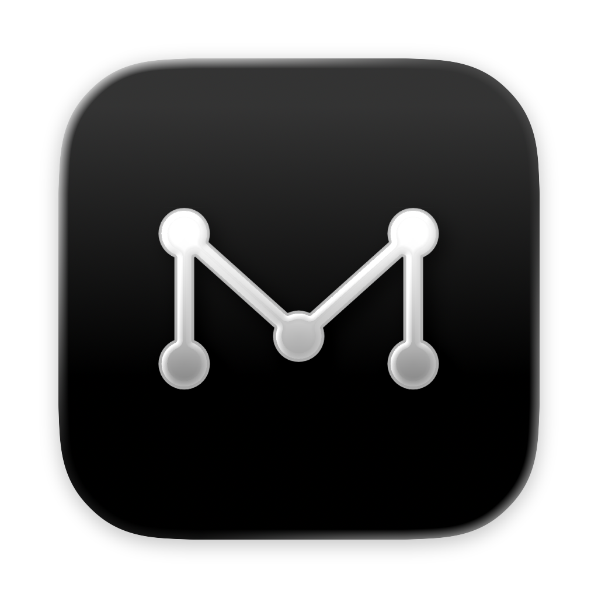
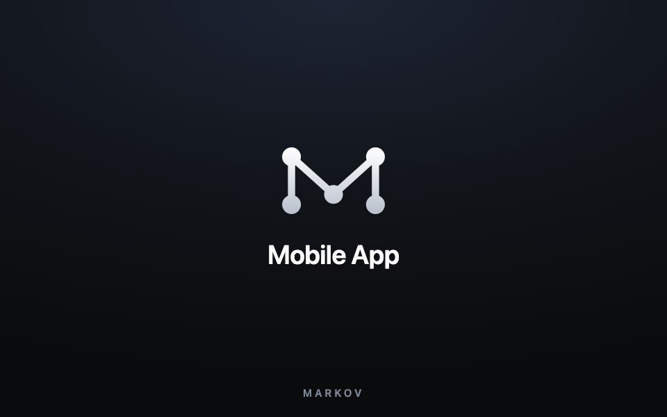
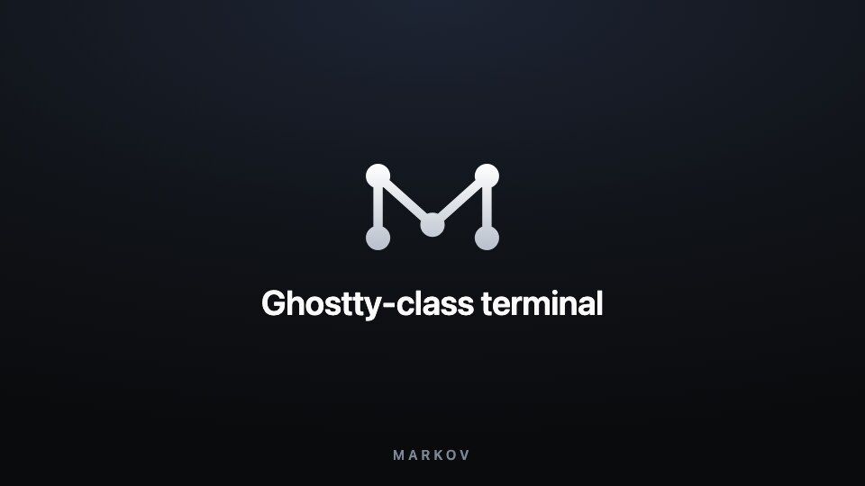
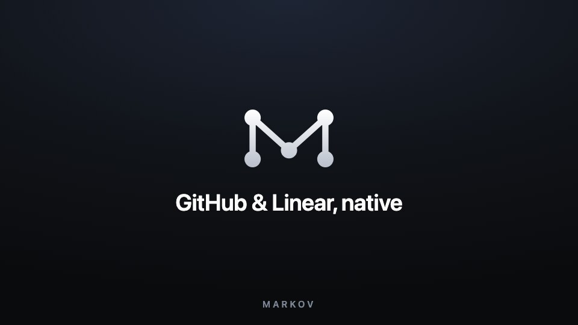
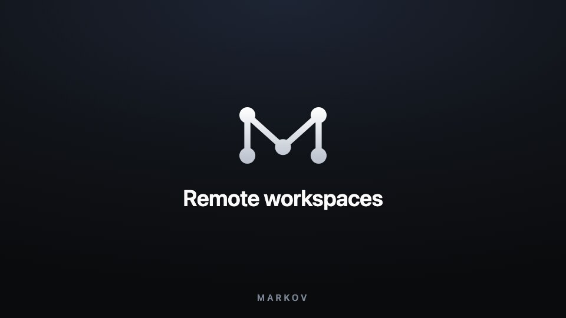
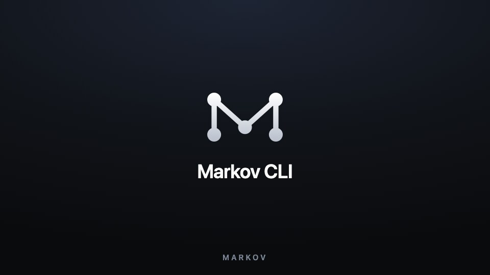

<h1 align="center">
  <a href="https://markov.outhad.com"></a> Markov
</h1>

<p align="center">
  <a href="https://github.com/tanzil7890/markov"></a>
  <a href="https://github.com/tanzil7890/markov/releases"></a>
  
  
</p>

<p align="center">
  <sub><a href="../../README.md">English</a> · <a href="README.zh-CN.md">中文</a> · <a href="README.ja.md">日本語</a> · <a href="README.ko.md">한국어</a> · <a href="README.es.md">Español</a> · <a href="README.fr.md">Français</a> · <a href="README.pt.md">Português</a> · <a href="README.ru.md">Русский</a></sub>
</p>

<p align="center">
  <strong>100x geliştiriciler için yapay zekâ orkestratörü.</strong><br/>
  Codex, Claude Code, OpenCode veya Pi'yi yan yana çalıştırın - her biri kendi worktree'sinde, hepsi tek yerden takip edilir.
</p>

<h3 align="center"><a href="https://markov.outhad.com/download"><ins>Markov'yı indirin</ins></a></h3>

## Özellikler

<table>
<tr>
<td width="50%" valign="middle">

### Mobil Yardımcı

Ajanlarınızı telefonunuzdan izleyin ve yönlendirin - bir ajan işini bitirdiğinde bildirim alın, nerede olursanız olun takip talimatı gönderin.

[iOS App Store](https://markov.outhad.com/download/ios) · [Android APK](https://markov.outhad.com/download/android) · [Dokümanlar →](https://markov.outhad.com/docs/mobile)

</td>
<td width="50%">
  <a href="https://markov.outhad.com/docs/mobile"><picture><source srcset="../assets/readme-features/mobile-companion.webp" type="image/webp"></picture></a>
</td>
</tr>
<tr>
<td width="50%" valign="middle">

### Paralel Worktree'ler

Tek bir prompt'u beş ajana birden dağıtın; her biri kendi izole git worktree'sinde çalışsın - sonuçları karşılaştırıp kazananı merge edin.

[Dokümanlar →](https://markov.outhad.com/docs/model/worktrees)

</td>
<td width="50%">
  <a href="https://markov.outhad.com/docs/model/worktrees"><picture><source srcset="../assets/readme-features/split-anything.webp" type="image/webp"></picture></a>
</td>
</tr>
<tr>
<td width="50%" valign="middle">

### Terminal Bölmeleri

WebGL ile çizilen Ghostty ayarında terminaller, sınırsız bölme ve yeniden başlatmadan sağ çıkan scrollback.

[Dokümanlar →](https://markov.outhad.com/docs/terminal)

</td>
<td width="50%">
  <a href="https://markov.outhad.com/docs/terminal"><picture><source srcset="../../resources/onboarding/feature-wall/tile-02.webp" type="image/webp"></picture></a>
</td>
</tr>
<tr>
<td width="50%" valign="middle">

### Tasarım Modu

Gerçek bir Chromium penceresindeki herhangi bir arayüz öğesine tıklayın; öğenin HTML'i, CSS'i ve kırpılmış ekran görüntüsü doğrudan ajanınızın prompt'una gitsin.

[Dokümanlar →](https://markov.outhad.com/docs/browser/design-mode)

</td>
<td width="50%">
  <a href="https://markov.outhad.com/docs/browser/design-mode"><picture><source srcset="../assets/readme-features/design-mode.webp" type="image/webp"></picture></a>
</td>
</tr>
<tr>
<td width="50%" valign="middle">

### GitHub ve Linear, Yerleşik

PR'ları, issue'ları ve proje panolarını uygulamanın içinde gezin - herhangi bir görevden worktree açın, bağlam değiştirmeden inceleyin.

[Dokümanlar →](https://markov.outhad.com/docs/review/linear)

</td>
<td width="50%">
  <a href="https://markov.outhad.com/docs/review/linear"><picture><source srcset="../../resources/onboarding/feature-wall/tile-03.webp" type="image/webp"></picture></a>
</td>
</tr>
<tr>
<td width="50%" valign="middle">

### SSH Worktree'leri

Ajanları güçlü bir uzak makinede çalıştırın; dosya düzenleme, git ve terminaller eksiksiz - otomatik yeniden bağlanma ve port yönlendirme dahil.

[Dokümanlar →](https://markov.outhad.com/docs/ssh)

</td>
<td width="50%">
  <a href="https://markov.outhad.com/docs/ssh"><picture><source srcset="../../resources/onboarding/feature-wall/tile-06.webp" type="image/webp"></picture></a>
</td>
</tr>
<tr>
<td width="50%" valign="middle">

### Yapay Zekâ Diff'lerine Not Düşün

Herhangi bir diff satırına yorum bırakın ve ajana geri gönderin - Markov'dan çıkmadan inceleyin, düzenleyin ve commit edin.

[Dokümanlar →](https://markov.outhad.com/docs/review/annotate-ai-diff)

</td>
<td width="50%">
  <a href="https://markov.outhad.com/docs/review/annotate-ai-diff"><picture><source srcset="../assets/readme-features/annotate-ai-diffs.webp" type="image/webp"></picture></a>
</td>
</tr>
<tr>
<td width="50%" valign="middle">

### Dosyaları Ajanlara Sürükleyin

Her yerde otomatik kaydeden VS Code editörü - dosyaları veya görselleri doğrudan bir ajan prompt'una sürükleyin.

[Dokümanlar →](https://markov.outhad.com/docs/editing/file-explorer)

</td>
<td width="50%">
  <a href="https://markov.outhad.com/docs/editing/file-explorer"><picture><source srcset="../../resources/onboarding/feature-wall/tile-07.gif" type="image/gif"></picture></a>
</td>
</tr>
<tr>
<td width="50%" valign="middle">

### Markov CLI

Markov'yı ajanlar da kullanır - her akışı `markov worktree create`, `snapshot`, `click` ve `fill` ile script'leyin.

[Dokümanlar →](https://markov.outhad.com/docs/cli/overview)

</td>
<td width="50%">
  <a href="https://markov.outhad.com/docs/cli/overview"><picture><source srcset="../../resources/onboarding/feature-wall/tile-09.webp" type="image/webp"></picture></a>
</td>
</tr>
</table>

**Kutudan çıkan diğerleri:**

- **[Hızlı açma](https://markov.outhad.com/docs/model/quick-open)** - Worktree'ler, dosyalar, ajanlar, komutlar ve repo bağlamı arasında akışınızdan çıkmadan arama yapın.
- **[Hesap değiştirme ve kullanım takibi](https://markov.outhad.com/docs/agents/usage-tracking)** - Claude ve Codex kullanımınızı ve limit sıfırlanma zamanlarını görün, yeniden giriş yapmadan hesaplar arasında geçiş yapın.
- **[Zengin repo önizlemeleri](https://markov.outhad.com/docs/editing/markdown)** - Çalışma alanında Markdown, görsel, PDF ve repo dokümanlarını önizleyin.
- **[Bilgisayar Kullanımı](https://markov.outhad.com/docs/cli/computer-use)** - Bir akış gerçek etkileşim gerektirdiğinde ajanların masaüstü uygulamalarını ve görünür arayüzü kullanmasına izin verin.
- **[Bildirimler ve okunmadı durumu](https://markov.outhad.com/docs/notifications)** - Bir ajan bittiğinde ya da ilginizi istediğinde haberiniz olsun; sonra dönmek için konuşmaları okunmadı olarak işaretleyin.
- **Ve çok daha fazlası** - her gün sürüm çıkarıyoruz, bu liste sürekli geride kalıyor. Asıl özellik listesi [changelog](https://github.com/tanzil7890/markov/releases).

---

## Desteklenen Ajanlar

**Herhangi bir CLI ajanıyla** çalışır - terminalde çalışan her şey Markov'da da çalışır.

<p>
  <a href="https://docs.anthropic.com/claude/docs/claude-code"><kbd> Claude Code</kbd></a> &nbsp;
  <a href="https://github.com/openai/codex"><kbd> Codex</kbd></a> &nbsp;
  <a href="https://x.ai/cli"><kbd> Grok</kbd></a> &nbsp;
  <a href="https://cursor.com/cli"><kbd> Cursor</kbd></a> &nbsp;
  <a href="https://docs.github.com/en/copilot/how-tos/set-up/install-copilot-cli"><kbd> GitHub Copilot</kbd></a> &nbsp;
  <a href="https://dev.meta.ai/docs/muse-code"><kbd> Muse</kbd></a> &nbsp;
  <a href="https://deepseek-harness.github.io/deepseek-harness/"><kbd> DeepSeek Harness</kbd></a> &nbsp;
  <a href="https://zcode.z.ai/en/docs"><kbd> ZCode</kbd></a> &nbsp;
  <a href="https://opencode.ai/docs/cli/"><kbd> OpenCode</kbd></a> &nbsp;
  <a href="https://mimo.xiaomi.com/coder"><kbd> MiMo Code</kbd></a> &nbsp;
  <a href="https://ampcode.com/manual#install"><kbd> Amp</kbd></a> &nbsp;
  <a href="https://openclaude.gitlawb.com/"><kbd> OpenClaude</kbd></a> &nbsp;
  <a href="https://antigravity.google/docs/cli-overview"><kbd> Antigravity</kbd></a> &nbsp;
  <a href="https://pi.dev"><kbd> Pi</kbd></a> &nbsp;
  <a href="https://omp.sh"><kbd> oh-my-pi</kbd></a> &nbsp;
  <a href="https://hermes-agent.nousresearch.com/docs/"><kbd> Hermes Agent</kbd></a> &nbsp;
  <a href="https://devin.ai/cli"><kbd> Devin</kbd></a> &nbsp;
  <a href="https://goose-docs.ai/docs/quickstart/"><kbd> Goose</kbd></a> &nbsp;
  <a href="https://docs.augmentcode.com/cli/overview"><kbd> Auggie</kbd></a> &nbsp;
  <a href="https://github.com/autohandai/code-cli"><kbd> Autohand Code</kbd></a> &nbsp;
  <a href="https://github.com/charmbracelet/crush"><kbd> Charm</kbd></a> &nbsp;
  <a href="https://docs.cline.bot/cline-cli/overview"><kbd> Cline</kbd></a> &nbsp;
  <a href="https://www.codebuddy.ai/cli"><kbd> CodeBuddy</kbd></a> &nbsp;
  <a href="https://www.codebuff.com/docs/help/quick-start"><kbd> Codebuff</kbd></a> &nbsp;
  <a href="https://freebuff.com"><kbd> Freebuff</kbd></a> &nbsp;
  <a href="https://commandcode.ai/docs/quickstart"><kbd> Command Code</kbd></a> &nbsp;
  <a href="https://docs.continue.dev/cli/quickstart"><kbd> Continue</kbd></a> &nbsp;
  <a href="https://docs.factory.ai/cli/getting-started/quickstart"><kbd> Droid</kbd></a> &nbsp;
  <a href="https://kilo.ai/docs/cli"><kbd> Kilocode</kbd></a> &nbsp;
  <a href="https://www.kimi.com/code/docs/en/kimi-code-cli/getting-started.html"><kbd> Kimi</kbd></a> &nbsp;
  <a href="https://kiro.dev/docs/cli/"><kbd> Kiro</kbd></a> &nbsp;
  <a href="https://github.com/mistralai/mistral-vibe"><kbd> Mistral Vibe</kbd></a> &nbsp;
  <a href="https://github.com/QwenLM/qwen-code"><kbd> Qwen Code</kbd></a> &nbsp;
  <a href="https://support.atlassian.com/rovo/docs/install-and-run-rovo-dev-cli-on-your-device/"><kbd> Rovo Dev</kbd></a> &nbsp;
  <kbd>+ her CLI ajanı</kbd>
</p>

---

## Kurulum

### Masaüstü - macOS, Windows, Linux

- **[markov.outhad.com üzerinden indirin](https://markov.outhad.com/download)**
- Ya da derlemeyi doğrudan alın: [macOS Apple Silicon](https://github.com/tanzil7890/markov/releases/latest/download/markov-macos-arm64.dmg) · [macOS Intel](https://github.com/tanzil7890/markov/releases/latest/download/markov-macos-x64.dmg) · [Windows (.exe)](https://github.com/tanzil7890/markov/releases/latest/download/markov-windows-setup.exe) · [Linux AppImage](https://github.com/tanzil7890/markov/releases/latest/download/markov-linux.AppImage) · [Tüm derlemeler](https://github.com/tanzil7890/markov/releases/latest)

_Ya da bir paket yöneticisiyle:_

```bash
# macOS (Homebrew)
brew install --cask tanzil7890/markov/markov
```

### Mobil Yardımcı - iOS, Android

Ajanlarınızı telefonunuzdan izlemek ve yönlendirmek için masaüstü uygulamanızla eşleştirin.

- **iOS:** [App Store'dan indirin](https://markov.outhad.com/download/ios)
- **Android:** [APK'yı indirin](https://markov.outhad.com/download/android) · [Kurulum rehberi](https://markov.outhad.com/docs/android-apk)

---

## Topluluk ve Destek

- **GitHub:** [Report a bug or request a feature](https://github.com/tanzil7890/markov/issues).
- **Geri bildirim ve fikirler:** Hızlı sürüm çıkarıyoruz. Eksik bulduğunuz bir şey mi var? [Yeni bir özellik isteyin](https://github.com/tanzil7890/markov/issues).
- **Gizlilik:** Markov'nın hangi anonim kullanım verisini topladığını ve bunu nasıl kapatacağınızı [gizlilik ve telemetri dokümanlarında](https://markov.outhad.com/docs/telemetry) bulabilirsiniz.
- **Destek olun:** Günlük sürümleri takip etmek için bu repoyu [yıldızlayın](https://github.com/tanzil7890/markov).

---

## Geliştirme

Katkıda bulunmak veya yerelde çalıştırmak ister misiniz? [CONTRIBUTING.md](../../.github/CONTRIBUTING.md) rehberimize bakın.

Mobil uygulamayı bir masaüstü sunucusuyla eşleştiren relay de bu repoda,
[`cloud/`](../../cloud/README.md) altında yer alıyor; ayrı bir pnpm workspace'i ve kurulum rehberi var.

<a href="https://github.com/tanzil7890/markov/graphs/contributors">
  
</a>

<p align="center">
  
</p>

## İmzalı Derlemeler

Windows kod imzalama [SignPath.io](https://signpath.io) tarafından sağlanmaktadır, sertifika [SignPath Foundation](https://signpath.org) tarafından verilmiştir.

## Lisans

Markov, [MIT Lisansı](../../LICENSE) altında ücretsiz ve açık kaynaktır.
